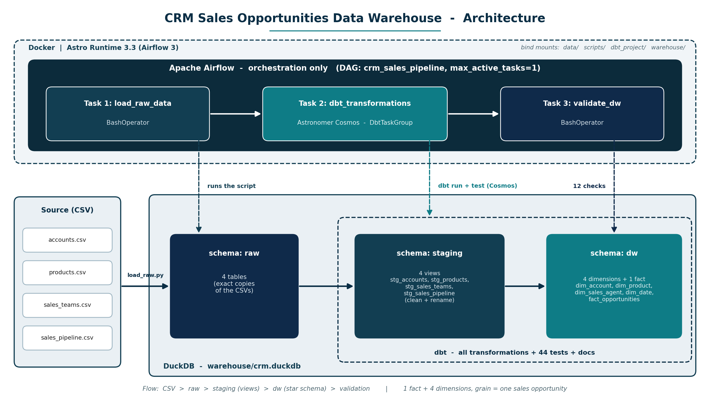
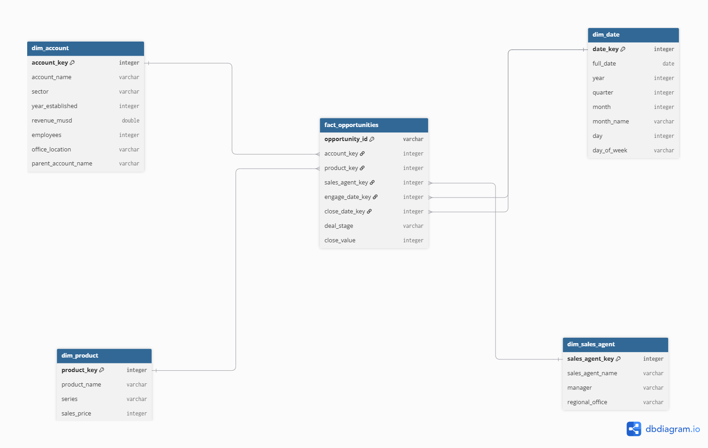
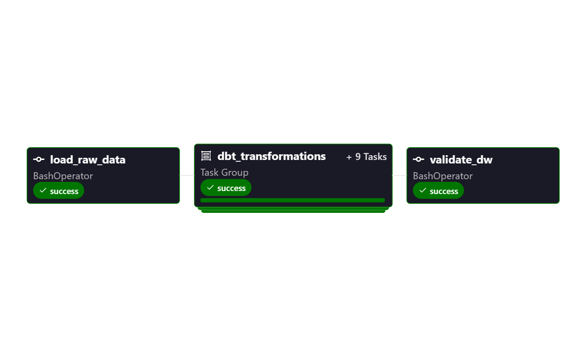

# CRM Sales Opportunities Data Warehouse

An end-to-end ELT project on the Maven Analytics **CRM Sales Opportunities** dataset (8,800 opportunities): raw CSVs are loaded into **DuckDB**, modeled into a **star schema** with **dbt**, and orchestrated by **Apache Airflow 3** with **Astronomer Cosmos**, all running in Docker.

> Built for the DEPI Microsoft Data Engineer track.

## Architecture



```
CSV  ->  raw (DuckDB)  ->  staging (dbt views)  ->  dw (dbt tables, star schema)  ->  validation
                 Airflow + Cosmos orchestrate every step
```

| Layer | Schema | Built by | Content |
|---|---|---|---|
| Raw | `raw` | `scripts/load_raw.py` | Exact copies of the CSVs. Never cleaned. |
| Staging | `staging` | dbt (views) | Renames and typo fixes. No joins, no business logic. |
| Warehouse | `dw` | dbt (tables) | 1 fact + 4 dimensions |
| Validation | - | `scripts/validate_dw.py` | 12 reconciliation checks against raw |

## Star schema

- **Grain:** one row in `fact_opportunities` = one sales opportunity.
- **Fact:** `fact_opportunities`
- **Dimensions:** `dim_account`, `dim_product`, `dim_sales_agent`, `dim_date` (role-playing: engage date and close date)
- **Unknown member (key -1)** in `dim_account` and `dim_date`, so open deals never disappear from joins.



## Results

| Measure | Result |
|---|---|
| Fact rows | 8,800 = source rows, 0 duplicates, 0 NULL or orphan keys |
| Total `close_value` | 10,005,534 in raw = staging = fact |
| dbt tests | 44 / 44 pass (`dbt build` = 9 models + 44 tests = 53 nodes) |
| Validation checks | 12 / 12 pass |
| Airflow run | Success in 2 min 53 s (30 task instances, one at a time) |



## Data-quality issues found and fixed

1. `GTXPro` vs `GTX Pro`: 1,480 pipeline rows (about 17%) silently failed to join. Fixed with an explicit mapping in staging; a `relationships` test proves 0 orphans.
2. `technolgy` (12 accounts) and `Philipines` (1 account) typos, fixed in staging.
3. About 16% of deals have no account or date because they are still open. Handled with the Unknown member instead of NULL keys.
4. Windows `Access is denied` on project folders (different from the DuckDB `Conflicting lock` error). Solved with `icacls` on the specific folders, without running as Administrator.

Raw data is never edited; every fix is visible and testable in staging.

## Highlights

- **Tests that were tested:** tests were broken on purpose to prove they fail (`FAIL 1`, then back to `PASS`).
- **Reconciliation inside dbt:** two singular tests (`tests/assert_fact_*`) check that the fact matches staging in row count and in total `close_value`, and they appear in the lineage graph.
- **Reconciliation, not just pass counts:** row counts and value totals match from raw to fact.
- **Cosmos lineage:** every dbt model, and every test that spans two models, is visible in the Airflow graph.
- **DuckDB single-writer lesson:** parallel tasks caused `Conflicting lock is held`; solved with `max_active_tasks=1`.
- **Physical schema generated from the live database** (`scripts/describe_dw.py`), not copied from the design.


## How to run

Prerequisites: Python 3.11+, Docker Desktop, Astro CLI (PowerShell commands).

**Without Airflow**

```powershell
python -m venv .venv
.venv\Scripts\Activate.ps1
pip install -r requirements.txt
python scripts/load_raw.py
cd dbt_project
dbt build --profiles-dir .
cd ..
python scripts/validate_dw.py
```

**Full pipeline with Airflow**

```powershell
cd airflow
astro dev start
```

Open the Airflow UI at the address printed by `astro dev start` (Astro may pick a random port on Windows), then trigger `crm_sales_pipeline`.

Do not open `warehouse/crm.duckdb` in another tool while the DAG is writing to it.

## Project structure

```
data/raw/        source CSVs
scripts/         load_raw.py, validate_dw.py, describe_dw.py, profiling and check scripts
dbt_project/     dbt models (staging, marts), tests (2 singular tests), macros, profiles
airflow/         Astro project: Dockerfile, requirements.txt, docker-compose.override.yml, dags/
warehouse/       crm.duckdb (generated)
docs/            schemas, architecture, lineage, DAG image, full documentation PDF
```

## Documentation

Full documentation with design decisions, issues log and lessons learned: [`docs/project_documentation.pdf`](docs/project_documentation.pdf)

## Stack

Python | DuckDB | dbt | Apache Airflow 3 | Astronomer Cosmos | Docker | Astro CLI
